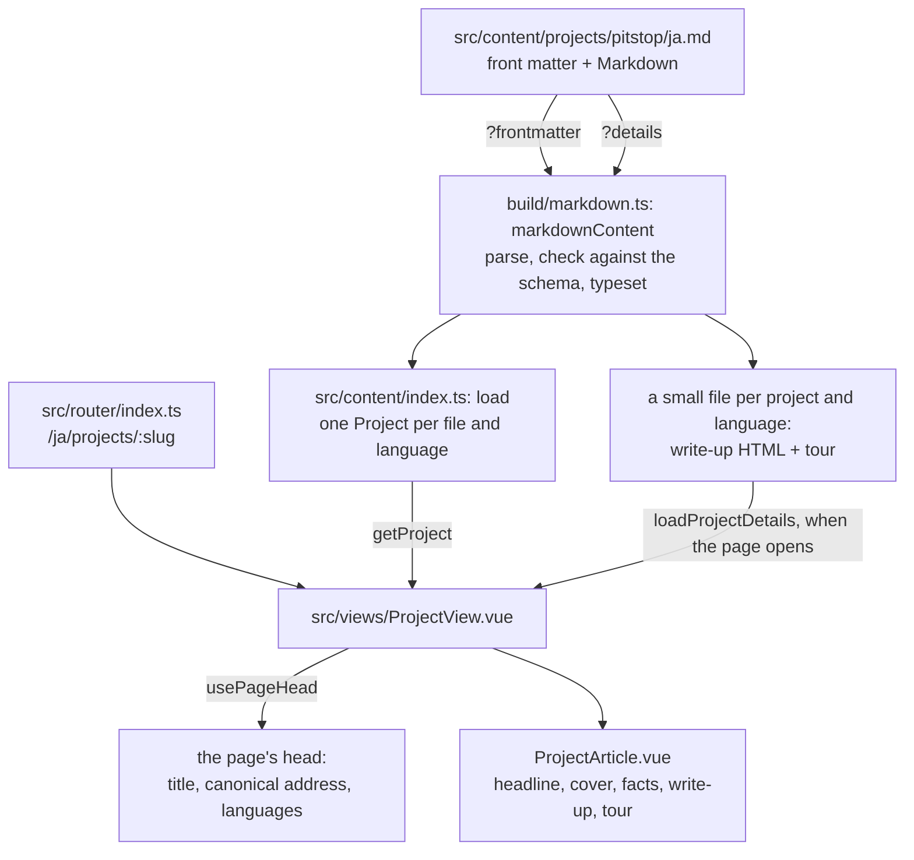

# How the site works

A plain-English guide to this repository: what the site is, how a project
folder becomes a page, the words the code uses, and where to make common
changes. The README has the commands and the folder map; this goes one level
deeper.

## What the site is

Muhammad Nabil Rinaldi's portfolio, at https://nabilrobert.my.id. It is a
single-page app: the browser downloads the site once, and moving between
pages happens without a full reload. It comes in three languages: English at
`/`, Japanese under `/ja` and Indonesian under `/id`.

Every project is a folder of files, not code. The home page shows a cover
for each project; a project's page has its write-up and a guided tour of its
screenshots and charts. Nothing is fetched from a server or a database: the
build turns the content into files that any static web host can serve.

## The flow: from a project folder to a page

Take Pitstop, opened in Japanese at `/ja/projects/pitstop`.

1. **The content.** `src/content/projects/pitstop/ja.md` starts with front
   matter (the title, summary, links, status, tour and so on, as YAML between
   two `---` lines), followed by the write-up in Markdown.
2. **The content is asked for in two parts.** `src/content/index.ts` uses
   Vite's `import.meta.glob` to import every `.md` file twice. With
   `?frontmatter`, it gets what cards and headings need, bundled with the
   site. With `?details`, it gets the write-up and the tour, as a separate
   small file that is only downloaded when that project's page opens.
3. **The build turns each part into data.** `build/markdown.ts: markdownContent`
   is a Vite plugin. For each import, `markdownPart` reads which part is
   wanted, and `partValue` does the work:
   - `parseMarkdown` splits the front matter from the Markdown (gray-matter)
     and turns the Markdown into HTML (marked, with SmartyPants for curly
     quotes);
   - `checkedFrontMatter` checks the front matter against the schema in
     `src/content/schema.ts` (`projectFrontMatter`) and typesets its
     reader-facing text with `typesetFrontMatter`. A mistake stops the build
     with the file's name and what is wrong.
4. **Drafts are dropped first.** In a production build,
   `build/markdown.ts: draftContent` runs before the step above. For a project
   whose `en.md` says `draft: true` (`isDraftProject`), it replaces every file
   with an empty stub, so none of its text or images reaches the site.
5. **The content becomes projects.** `src/content/index.ts: load` turns each
   file's front matter into a `Project` (`toProject`, with the cover found by
   `coverFor`), grouped by language and sorted by `order`. Pages read them
   through `getProjects`, `getProject` and `getProjectsByCategory`.
6. **The app starts.** `src/main.ts` creates the Vue app with the router
   (`src/router/index.ts: createAppRouter`) and the head manager (@unhead/vue).
7. **The router picks the page.** `/ja/projects/pitstop` matches the
   Japanese project route, which shows `src/views/ProjectView.vue` with
   `slug: 'pitstop'` and records the language in the route's `meta.lang`.
   `src/composables/useLocale.ts: useLocale` reads it from there, giving
   every component the current language, its strings (`t`) and helpers for
   links that stay in that language.
8. **The page loads its details.** `ProjectView.vue` gets the project with
   `getProject`, then calls `src/content/index.ts: loadProjectDetails`, which
   downloads the write-up and tour and turns each image name into its built
   file (`toTourScreenshot`, `imageFor`). If the reader has already moved on
   when the reply arrives, it is dropped.
9. **The page sets its head.** `src/composables/usePageHead.ts: usePageHead`
   sets the browser tab's title, the description, the link-preview tags, the
   canonical address and the address of the same page in each other language.
10. **The page is drawn.** `src/components/sections/ProjectArticle.vue`
    splits the title into the headline and subtitle (`splitTitle`), then shows
    the cover (`CoverImage`), the facts and links (`TextLink`), the write-up,
    and one `TourStop` per screenshot or chart.

The home page works the same way, with less: `src/views/HomeView.vue` asks
`getProjectsByCategory` for the projects, `ProjectGrid` shows a `ProjectCard`
for each, and `AboutSection` adds the about paragraph and how the projects
relate. No details are downloaded for it.

The production build also writes `sitemap.xml` and `robots.txt`
(`build/sitemap.ts: sitemap`), listing every published page in every language.

## Glossary

- **Vite:** the tool that runs the site while you work on it (`npm run dev`)
  and builds the files that go online (`npm run build`). Settings:
  `vite.config.ts`.
- **Vite plugin:** a piece of code that changes how Vite treats some files.
  This site has three, in `build/`: `markdownContent` and `draftContent`
  (`build/markdown.ts`) and `sitemap` (`build/sitemap.ts`).
- **Front matter:** the settings at the top of a Markdown file, between two
  `---` lines, written in YAML. For a project: its title, summary, category,
  order, status, links and tour.
- **Schema:** the rules front matter must follow, written with Zod in
  `src/content/schema.ts`. The TypeScript types in `src/content/types.ts` are
  built from it, so the rules and the types can't drift apart.
- **Locale:** one of the site's languages: `en`, `ja` or `id`. Each has a route
  prefix (`''`, `/ja`, `/id`, in `src/content/constants.ts`) and its interface
  strings in `src/content/locales/`.
- **Interface strings:** the site's own text (menus, headings, labels), as
  opposed to project content. `en.ts` is the reference.
- **`satisfies LocaleStrings`:** the last line of `ja.ts` and `id.ts`. It tells
  TypeScript to check that the file has exactly the same keys as `en.ts`, so a
  missing or misspelt string fails the type check.
- **Composable:** a function that components share, named `use…`:
  `useLocale` (the current language and its strings) and `usePageHead` (the
  page's head).
- **Tailwind tokens:** the named colours and fonts in `src/styles/theme.css`
  (`ink`, `cream`, `yellow`, …), used in class names such as `text-cream` or
  `bg-ink`. Tailwind's own colours are switched off, so only these exist.
- **Utilities:** the site's own Tailwind classes, also in `theme.css`:
  `eyebrow` (small spaced capitals), `display` (wide capitals) and `frame`
  (the page's width and margins).
- **Draft and published:** a project with `draft: true` in its front matter
  appears in `npm run dev`, tagged "Draft, not published", and is left out of
  production builds entirely. Removing the line publishes it.
- **Status:** the label on a project page, such as "Live", "CI" or "In review".
  The allowed values are in `src/content/constants.ts` (`statuses`); each needs
  a label in every language.
- **Cover:** the 5:7 picture for a project (`cover.svg`). Covers are drawn by
  hand as SVG, in the site's palette, with the lettering (Cinzel, and Noto
  Serif JP for kanji) converted to outlines so they need no font files. There
  is no cover generator in this repository; edit the SVG.
- **Source record:** a `<name>.source.txt` beside every image, saying where it
  came from. A test fails if one is missing.
- **Tour and tour stop:** a project page's guided tour. Each stop is one
  screenshot or chart from the `screenshots` front matter, with a walk-through
  (`description`) and a key (`terms`), shown by `src/components/ui/TourStop.vue`.
- **Still:** a still image shown instead of an animation to visitors who
  prefer reduced motion (`still` in the front matter).
- **Language version of an image:** `chart.ja.svg` is used instead of
  `chart.svg` on the Japanese page, if it exists (`imageFor`).
- **Narrow chart:** `chart-narrow.svg`, the same chart drawn 360 px wide, shown
  on phones instead of the wide one.
- **Vega-Lite chart:** the result charts are described in `charts/*.ts` and
  drawn to SVG by `npm run charts` (`charts/render.ts: render`). A test fails
  if a committed SVG no longer matches its description (the drift test,
  `tests/charts.spec.ts`).
- **SmartyPants:** turns straight quotes into curly ones (`Anna's` becomes
  `Anna’s`) at build time.
- **Canonical address and hreflang:** tags in a page's head that tell search
  engines the page's one true address, and where the same page is in each
  other language.
- **Open Graph:** the `og:` tags that give a link its title and description
  when it is shared in a chat or on social media.
- **CI:** the checks GitHub runs on every pull request
  (`.github/workflows/ci.yml`): the same `npm run check` you run locally.

## Layout

See the table in the [README](../README.md). In short: content in
`src/content/`, pages in `src/views/`, building blocks in `src/components/`
(`layout/`, `sections/`, `ui/`), styles in `src/styles/`, build-time code in
`build/` and `charts/`, tests in `tests/`.

## Where to change things

- **Add a project:** make a folder `src/content/projects/<slug>/` with
  `en.md`, `ja.md` and `id.md`. Copy the front matter of a similar project and
  change it; `order` sets its place. Add a `cover.svg` and a
  `cover.source.txt`. Start with `draft: true` and look at it in
  `npm run dev`. `npm run check` tells you about anything missing or
  different between the languages.
- **Translate a project:** edit its `ja.md` and `id.md`. The links, settings
  and images must match `en.md` (a test checks); only the words differ.
- **Change interface text:** `src/content/locales/en.ts`, `ja.ts` and `id.ts`.
  Add a new string to all three.
- **Add a tour stop:** add an entry under `screenshots:` in all three Markdown
  files, put the image in the project folder, and give it a `.source.txt`.
- **Change or add a chart:** a chart's data and drawing are in
  `charts/<name>.ts` and its words, in all three languages, in
  `charts/<name>.text.ts`. Add a new chart to the `charts` list in
  `charts/render.ts`. Then run `npm run charts` and commit the SVGs it writes.
- **Change the palette or fonts:** `src/styles/theme.css`. The chart colours
  are in `charts/theme.ts` (`C`); after changing them, run `npm run charts`.
  The contrast notes at the top of `theme.css` say which colours are dark or
  light enough for text.
- **Add a page:** add a view in `src/views/` that calls `usePageHead`, add it
  to `pageRoutes` in `src/router/index.ts` (it then exists in all three
  languages), add its strings to the locale files, and, if it belongs in the
  menu, to `links` in `src/components/layout/SiteHeader.vue`.
- **Add a status:** add it to `statuses` in `src/content/constants.ts` and a
  label for it under `status` in each locale file.
- **Change the contact details or the domain:** `src/content/profile.ts`.
- **Before committing:** run `npm run check`. It runs the type check, ESLint
  (including the size limits), the formatting check, the tests and a
  production build, the same as CI.
